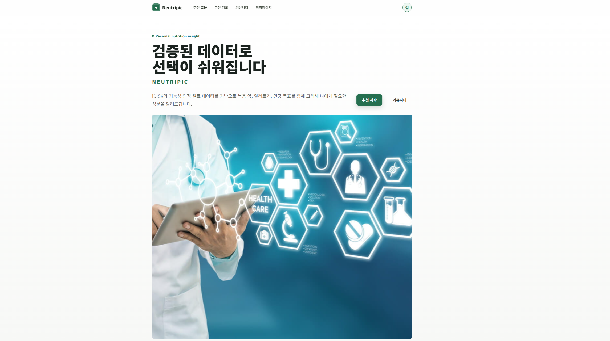
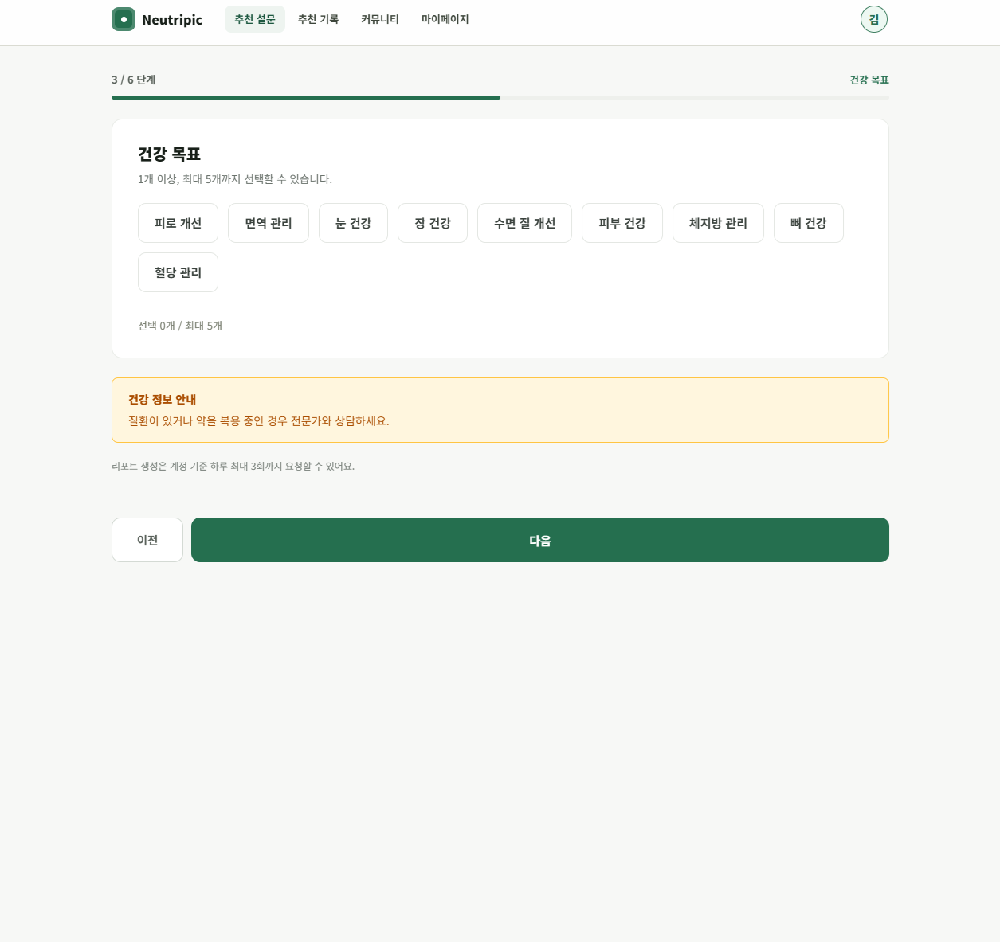
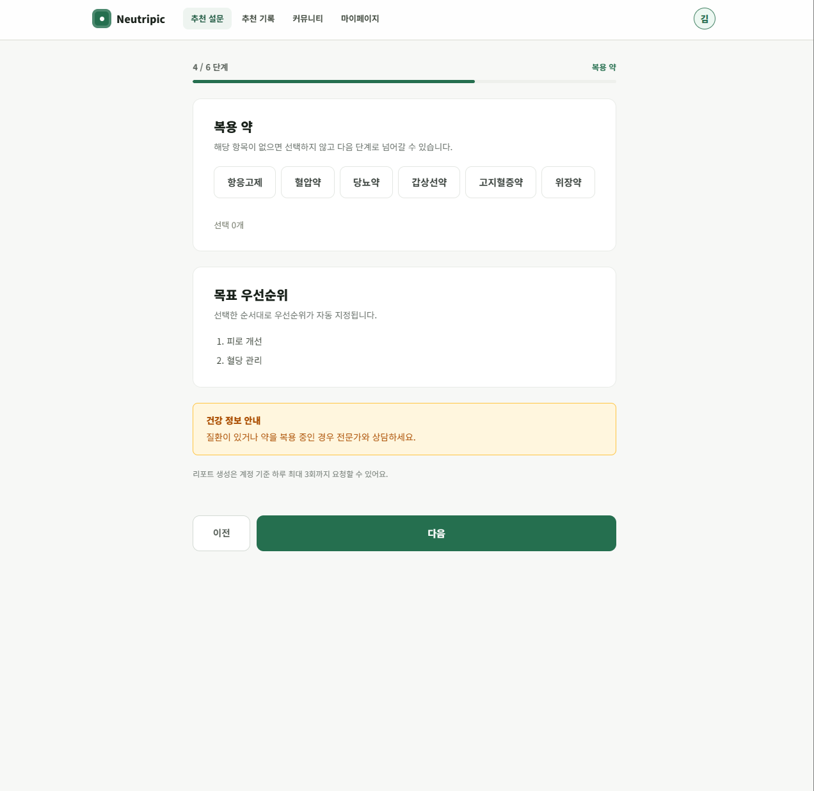
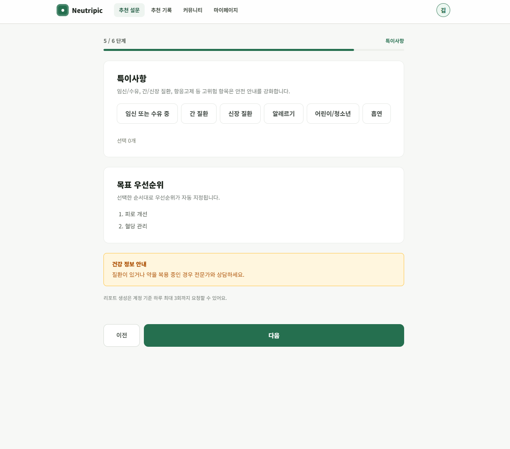
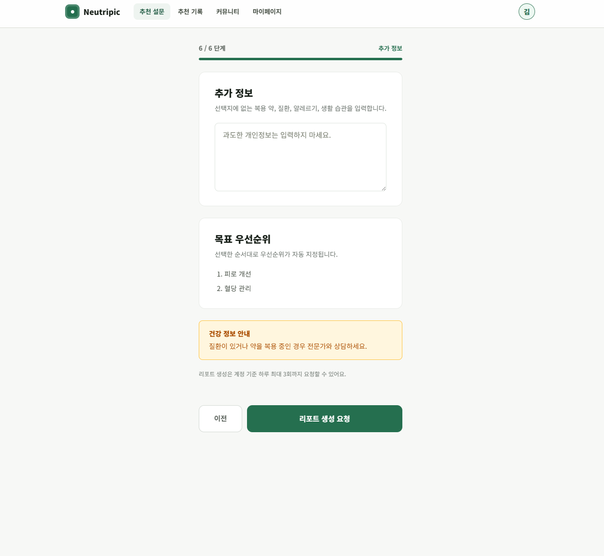
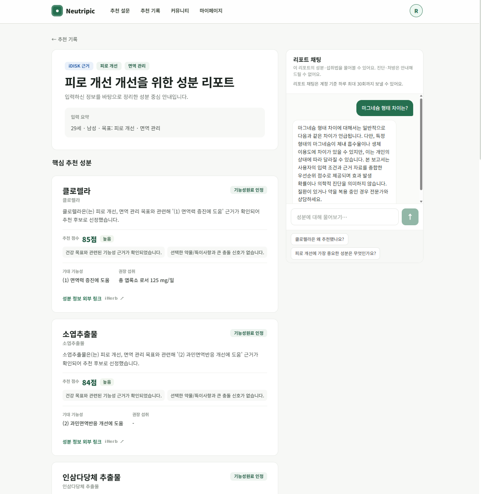
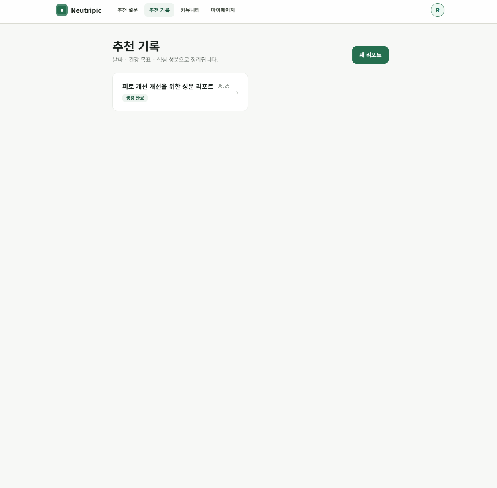
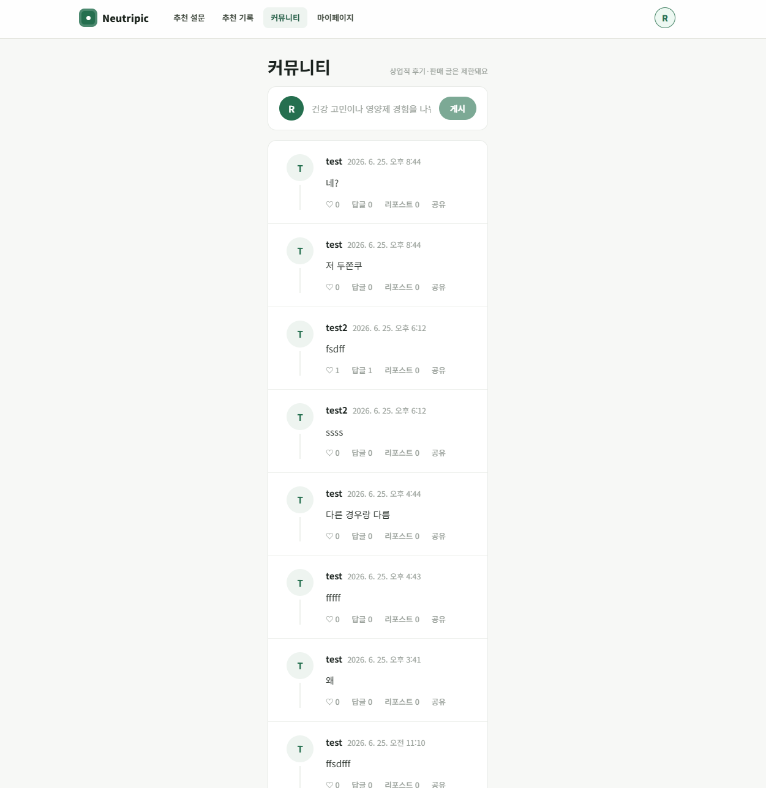
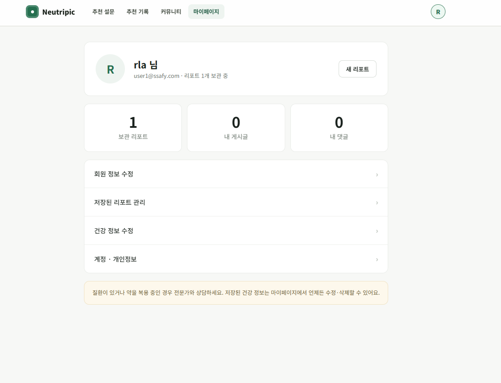
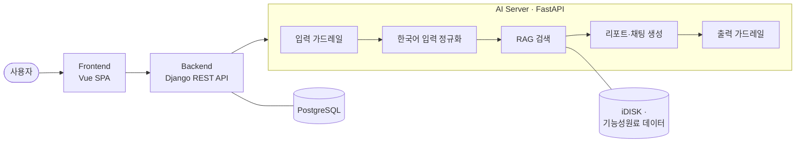

# 뉴트리픽 (Neutripic)
**검증된 데이터를 근거로 제품이 아닌 성분을 추천하는 건강기능식품 AI 리포트 서비스**

사용자는 건강 목표, 나이와 성별, 복용 중인 약, 특이사항을 입력하고 나에게 맞는 성분 리포트를 받습니다.
리포트를 본 뒤에는 그 내용을 바탕으로 AI에게 이어서 질문할 수 있습니다.

> 본 서비스는 건강 정보 제공 목적이며 질병 진단, 치료, 처방을 대체하지 않습니다. 질환이 있거나 약을 복용 중인 경우 전문가와 상담하세요.

## 기획 배경

건강기능식품은 종류가 많고 정보는 대부분 제품 광고 중심입니다.
무엇이 나에게 필요한 성분인지, 지금 먹는 약과 함께 먹어도 되는지는 스스로 알아내기 어렵습니다.
생성형 AI에게 물어볼 수는 있지만, 근거 없이 그럴듯한 답을 받을 위험이 있습니다.

뉴트리픽은 이 문제를 세 가지로 풉니다.

- **제품이 아닌 성분을 추천합니다.** 상품 순위를 매기지 않고, 건강 목표에 맞는 성분과 그 이유·용량·주의사항을 설명합니다.
- **검증된 데이터를 근거로 답합니다.** iDISK 데이터와 건강기능식품 기능성원료 인정현황을 검색해, 찾은 근거를 바탕으로 리포트를 만듭니다.
- **안전을 먼저 확인합니다.** 복용 약, 질환, 임신·수유, 알레르기를 반영하고, 진단·처방·약물 변경에 해당하는 요청은 입력과 출력 양쪽에서 걸러 전문가 상담을 안내합니다.

## 주요 기능

### 추천 설문

나이, 성별, 건강 목표(최대 5개와 우선순위), 복용 약, 특이사항을 단계별로 입력합니다.

<table>
  <tr>
    <td align="center"></td>
    <td align="center"></td>
  </tr>
  <tr>
    <td align="center"><b>건강 목표 선택</b> 관심 있는 건강 목표를 고릅니다</td>
    <td align="center"><b>복용 약과 우선순위</b> 복용 중인 약과 목표의 우선순위를 정합니다</td>
  </tr>
  <tr>
    <td align="center"></td>
    <td align="center"></td>
  </tr>
  <tr>
    <td align="center"><b>특이사항 선택</b> 질환, 임신·수유, 알레르기 등을 알려 줍니다</td>
    <td align="center"><b>추가 정보 입력</b> 더 전하고 싶은 내용을 자유롭게 적습니다</td>
  </tr>
</table>

### AI 성분 리포트와 후속 채팅

입력을 한국어에서 영어 검색 질의로 정규화해 근거를 검색하고, 성분별 추천 이유·기능성·용량·부작용·주의사항을 정리합니다.
저장된 리포트의 추천 성분과 근거를 바탕으로 후속 질문에 답하며, 리포트 범위를 벗어나거나 의료적으로 위험한 요청은 전문가 상담 안내로 대체합니다.

### 추천 기록

받은 리포트는 추천 기록으로 저장되어 언제든 다시 볼 수 있습니다.

### 커뮤니티

게시글과 댓글·답글을 쓰고, 게시글을 추천하며, 최신순·추천순으로 정렬해 봅니다.

### 마이페이지

내 정보와 활동 내역을 확인하고 수정합니다.

## 기술 스택

| 영역 | 사용 기술 |
| --- | --- |
| Frontend | Vue 3, Vue Router, Vite, Vitest |
| Backend | Python, Django 6, Django REST Framework, Simple JWT, SQLite(로컬)·PostgreSQL(배포) |
| AI Server | FastAPI, Pydantic, OpenAI SDK, ChromaDB |
| Data | iDISK 2.0, 건강기능식품 기능성원료 인정현황, iHerb 성분 링크 매핑 |
| Infra | Render(Backend·AI Server), Vercel(Frontend), gunicorn, whitenoise |

각 영역의 실행 방법은 [프로젝트 보고서](docs/project-report.md)를 참고하세요.

## 시스템 아키텍처

Backend는 인증·권한·저장·사용량 제한과 iHerb 성분 링크 매핑을 맡고, AI Server는 내부 API로만 호출됩니다.

## 팀원

| 이름  | 역할              |
|-----|-----------------|
| 정유진 | 팀장 · Frontend · AI |
| 김지윤 | Backend · AI |

## Repository

- `frontend/`: Vue 3 + Vite 클라이언트
- `backend/`: Django REST API 서버
- `ai/`: FastAPI 기반 가드레일·RAG 검색·리포트 생성 서버
- `ai_data/`: iDISK, 성분, 카테고리 원본·보조 데이터
- `docs/`: 기획, API 명세, 프론트엔드 설계, 팀 컨벤션

## Collaboration

- [AI Agent Instructions](AGENTS.md)
- [프로젝트 보고서](docs/project-report.md)
- [Git Conventions](docs/conventions/git-conventions.md)
- [API Conventions](docs/conventions/api-conventions.md)
- [Backend API 명세](docs/api/backend-api-spec.md)
- [AI API 명세](docs/api/ai-api-spec.md)
- [Frontend 설계](docs/frontend/README.md)
