# Neutripic

뉴트리픽(Neutripic)은 사용자의 건강 목표, 나이와 성별, 복용 중인 약, 특이사항을 바탕으로 건강기능식품 **제품이 아닌 성분 중심 AI 리포트**를 생성하는 웹 애플리케이션입니다.  
iDISK 증상/성분 데이터와 건강기능식품 기능성원료 인정현황 데이터를 RAG 검색 근거로 활용하고, 리포트 기반 후속 채팅, 추천 기록, 커뮤니티 기능을 제공합니다.

> 본 서비스는 건강 정보 제공 목적이며 질병 진단, 치료, 처방을 대체하지 않습니다. 질환이 있거나 약을 복용 중인 경우 전문가와 상담하세요.

## 1. 프로젝트 개요

### 1.1 목표 서비스

- 사용자 건강 목표와 특이사항을 반영한 개인화 성분 추천 리포트
- iDISK와 기능성원료 인정현황 기반 RAG 검색
- 한국어 사용자 입력을 영어 기반 데이터와 매칭하는 정규화/검색 흐름
- 의료 안전성, 프롬프트 인젝션, 서비스 범위 제한을 고려한 AI 가드레일
- 검증된 iHerb 성분 외부 링크 제공
- 리포트 기반 채팅과 추천 기록 저장
- 사용자 커뮤니티와 관리자 관리 기능

### 1.2 필수 요구사항 대응

| 요구사항 | 대응 내용 |
| --- | --- |
| F1301 사용자 추천 | 건강 목표, 복용 약, 특이사항, RAG 근거를 기반으로 성분 중심 AI 리포트를 생성합니다. |
| F1302 API 활용 | Django 백엔드가 FastAPI AI/RAG 내부 API를 호출하고, OpenAI provider 설정 시 생성형 AI를 사용하며 미설정 환경에서는 fallback/template 응답으로 API 계약을 유지합니다. |
| F1303 커뮤니티 | 게시글, 댓글, 답글, 추천/추천 취소, 최신순/추천순 정렬 기능을 제공합니다. |
| F1304 RESTful 원칙 | `/api/v1/` 기반의 자원 중심 URL, HTTP method, trailing slash, snake_case payload 규칙을 사용합니다. |
| F1305 서비스 배포 | AI 서버와 백엔드는 Render, 프론트엔드는 Vercel에 배포했습니다. |
| NF1301 Git 활용 | `develop` 기반 브랜치 작업과 prefix 기반 커밋/PR 규칙을 문서화했습니다. |
| NF1302 API Key 관리 | Django, AI 서버 모두 비밀 값을 환경변수로 관리합니다. |
| NF1303 데이터 확보 | iDISK CSV, 기능성원료/성분 데이터, iHerb 성분 링크 매핑 fixture와 processed data를 포함합니다. |
| NF1304 페이지 다양성 | 홈, 인증, 설문, 리포트, 마이페이지, 커뮤니티, 관리자 페이지를 포함합니다. |

## 2. 팀원 및 업무 분담

| 이름 | 담당 영역 | 주요 업무 |
| --- | --- | --- |
| 정유진(팀장) | Frontend, AI, Data/Integration | Vue SPA, 라우팅, 설문 화면, 리포트 화면, 리포트 채팅 UI, 커뮤니티/마이페이지/관리자 화면, AI 연동 화면 흐름, 데이터/API 연동 |
| 김지윤(팀원) | Backend, AI, Data/Integration | Django REST API, JWT 인증, DB 모델, 리포트/채팅 저장, FastAPI AI 서버, RAG 검색, 정규화, 가드레일, iHerb 매핑 |

## 3. 기술 스택

| 영역 | 기술 |
| --- | --- |
| Frontend | Vue 3, Vue Router, Vite, Vitest |
| Backend | Python, Django 6, Django REST Framework, Simple JWT |
| AI Server | FastAPI, Pydantic, OpenAI SDK, ChromaDB, local JSON RAG fallback |
| Database | SQLite local, PostgreSQL 배포 대응 |
| 배포/운영 | gunicorn, whitenoise, Render/Vercel 환경변수 대응 |
| 데이터 | iDISK 2.0, 기능성원료 데이터, iHerb 성분 링크 매핑 |

## 4. 시스템 구조

```text
Frontend(Vue SPA)
  -> Django REST API
      -> 사용자/JWT/권한/저장/사용량 제한
      -> iHerb 성분 링크 매핑
      -> Community API
      -> FastAPI AI Server
          -> input guardrail
          -> normalize
          -> RAG search
          -> report generate
          -> chat respond
          -> output guardrail
```

### 디렉터리 구조

```text
13_pjt/
  frontend/        Vue SPA
  backend/         Django REST API
  ai/              FastAPI AI/RAG server
  ai_data/         iDISK, 성분, 카테고리 원본/보조 데이터
  docs/            기획, API, 프론트엔드, AI/RAG 명세
```

## 5. 핵심 기능

### 5.1 AI 추천 리포트

1. 사용자가 건강 목표를 최대 5개까지 선택하고 우선순위를 지정합니다.
2. 나이, 성별, 복용 약, 특이사항, 자유 입력을 함께 제출합니다.
3. 백엔드가 JWT, 입력값, 사용량 제한을 검증합니다.
4. AI 서버가 입력 가드레일, 한국어 입력 정규화, RAG 검색을 수행합니다.
5. RAG 근거를 바탕으로 성분별 추천 이유, 기능성, 용량, 부작용, 주의사항을 생성합니다.
6. 백엔드가 추천 성분의 iHerb 매핑 URL을 붙이고 추천 기록으로 저장합니다.

### 5.2 추천 알고리즘 설명

뉴트리픽의 추천은 상품 랭킹이 아니라 성분 후보 선정과 설명 생성 흐름입니다.

```text
사용자 입력
-> 입력 가드레일
-> 한국어 입력 정규화
-> 영어 검색 질의 생성
-> iDISK/기능성원료 RAG 검색
-> 건강 목표 우선순위와 안전 조건 반영
-> 성분 후보 선정
-> RAG 근거 기반 리포트 생성
-> 출력 가드레일
```

성분 후보는 다음 신호를 조합하도록 설계했습니다.

- `rag_score`: 검색 결과와 사용자 입력의 관련도
- `goal_priority_weight`: 사용자가 선택한 건강 목표 우선순위
- `functional_data_bonus`: 기능성원료 인정현황에서 기능성/용량/주의사항 확인 여부
- `safety_penalty`: 복용 약, 질환, 임신/수유, 알레르기 등 주의 요인

AI 답변은 진단, 처방, 약물 중단/변경, 특정 제품 구매 유도 표현을 피하도록 입력/출력 가드레일을 거칩니다.

### 5.3 리포트 기반 채팅

저장된 리포트의 추천 성분, 주의사항, citations를 context로 사용해 후속 질문에 답합니다. 리포트 범위를 벗어난 질문이나 의료적으로 고위험인 요청은 전문가 상담 안내로 대체합니다.

### 5.4 커뮤니티

- 게시글 작성, 조회, 수정, 삭제
- 댓글/답글 작성, 수정, 삭제
- 게시글 추천/추천 취소
- 최신순/추천순 정렬
- 비회원 목록/상세 조회, 로그인 사용자 작성 가능

### 5.5 관리자

- 회원 목록/상세 조회 및 상태 관리
- 게시글 관리
- 댓글/답글 관리
- 추천 기록 통계 API는 선택 요구사항으로 분리

## 6. 주요 화면과 라우트

| 화면 | Route | 인증 |
| --- | --- | --- |
| 홈 | `/` | 선택 |
| 회원가입 | `/signup` | 비로그인 |
| 로그인 | `/login` | 비로그인 |
| 추천 설문 | `/survey` | 필요 |
| 리포트 생성 대기 | `/reports/generating` | 필요 |
| 신규 리포트 | `/reports/new` | 필요 |
| 추천 기록 목록 | `/reports` | 필요 |
| 리포트 상세 | `/reports/:report_id` | 필요 |
| 마이페이지 | `/mypage` | 필요 |
| 커뮤니티 목록 | `/community` | 선택 |
| 커뮤니티 상세 | `/community/:post_id` | 선택 |
| 게시글 작성 | `/community/new` | 필요 |
| 관리자 | `/admin`, `/admin/users`, `/admin/posts`, `/admin/comments` | 관리자 |

## 7. API 요약

### Backend API

Base URL: `/api/v1/`

| 영역 | Endpoint |
| --- | --- |
| Auth | `POST /auth/signup/`, `POST /auth/login/`, `POST /auth/token/refresh/`, `POST /auth/logout/` |
| Users | `GET/PATCH/DELETE /users/me/`, `PATCH /users/me/password/`, `GET /mypage/` |
| Metadata | `GET /health_goals/`, `GET /medication_options/`, `GET /special_condition_options/` |
| Reports | `GET/POST /reports/`, `GET/PATCH/DELETE /reports/{report_id}/` |
| Report Chat | `GET/POST /reports/{report_id}/messages/` |
| Community | `GET/POST /posts/`, `GET/PATCH/DELETE /posts/{post_id}/`, `POST/DELETE /posts/{post_id}/like/` |
| Comments | `GET/POST /posts/{post_id}/comments/`, `PATCH/DELETE /comments/{comment_id}/` |
| Admin | `/admin/users/`, `/admin/posts/`, `/admin/comments/`, `/admin/reports/statistics/` |

### AI Internal API

Base URL: `/internal/ai/v1/`

| Endpoint | 역할 |
| --- | --- |
| `POST /guardrails/input/` | 사용자 입력 가드레일 |
| `POST /normalize/` | 한국어 입력 정규화와 영어 검색 질의 생성 |
| `POST /rag/search/` | iDISK/기능성원료 RAG 검색 |
| `POST /reports/generate/` | 성분 중심 리포트 생성 |
| `POST /chat/respond/` | 리포트 기반 채팅 응답 |
| `POST /guardrails/output/` | 생성 결과 가드레일 |

## 8. 데이터베이스 모델링

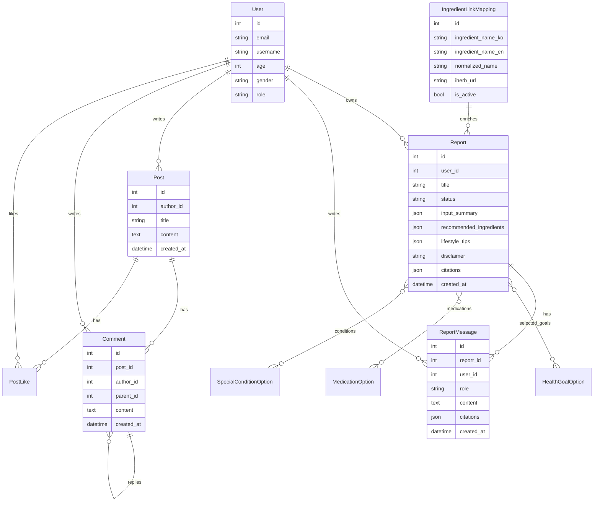

## 9. 실행 방법

### 9.1 Backend

```bash
cd backend
python -m venv .venv
source .venv/Scripts/activate
pip install -r requirements.txt
python manage.py migrate
python manage.py import_iherb_mappings
python manage.py runserver 127.0.0.1:8000
```

Windows PowerShell:

```powershell
cd backend
python -m venv .venv
.\.venv\Scripts\Activate.ps1
pip install -r requirements.txt
python manage.py migrate
python manage.py import_iherb_mappings
python manage.py runserver 127.0.0.1:8000
```

### 9.2 AI Server

```bash
cd ai
python -m venv .venv
source .venv/Scripts/activate
pip install -r requirements.txt
uvicorn app.main:app --reload --host 127.0.0.1 --port 8001
```

### 9.3 Frontend

```bash
cd frontend
npm install
npm run dev
```

기본 접속 주소:

- Frontend: `http://localhost:5173`
- Backend: `http://127.0.0.1:8000/api/v1/`
- AI Server: `http://127.0.0.1:8001`

## 10. 환경변수

환경변수 파일은 각 서비스 루트에 둡니다.

- Backend: `backend/.env`
- AI Server: `ai/.env`
- Frontend: `frontend/.env`

### Backend

```text
SECRET_KEY=
DEBUG=True
ALLOWED_HOSTS=localhost,127.0.0.1
CORS_ALLOWED_ORIGINS=http://localhost:5173,http://127.0.0.1:5173
CSRF_TRUSTED_ORIGINS=
DATABASE_URL=
AI_SERVER_BASE_URL=http://127.0.0.1:8001/internal/ai/v1
AI_INTERNAL_API_KEY=neutripic_local_ai_internal_key
AI_REQUEST_TIMEOUT_SECONDS=30
REPORT_DAILY_CREATE_LIMIT=3
REPORT_CHAT_DAILY_CREATE_LIMIT=30
```

배포 환경에서는 아래처럼 AI 서버 URL을 Render 배포 주소 기준으로 설정합니다.

```text
AI_SERVER_BASE_URL=https://nuetripic-ai.onrender.com/internal/ai/v1
AI_INTERNAL_API_KEY={배포 환경에 등록한 내부 API Key}
```

### AI Server

```text
AI_INTERNAL_API_KEY=neutripic_local_ai_internal_key
AI_ENV=local
AI_GENERATION_PROVIDER=fallback
OPENAI_API_KEY=
OPENAI_BASE_URL=
AI_MODEL_NAME=
AI_TEMPERATURE=0.2
AI_MAX_TOKENS=2000
RAG_VECTOR_BACKEND=local_json
CHROMA_PERSIST_DIR=app/data/chroma
CHROMA_COLLECTION_NAME=rag_documents
```

`AI_GENERATION_PROVIDER=fallback`이면 실제 LLM 호출 없이 template/fallback 응답으로 리포트와 채팅 응답 구조를 유지합니다. `OPENAI_API_KEY`, `AI_MODEL_NAME` 등을 설정하고 provider를 OpenAI 계열로 바꾸면 실제 생성형 AI 호출을 사용할 수 있도록 설계했습니다.

### Frontend

```text
VITE_API_BASE_URL=http://127.0.0.1:8000/api/v1
VITE_DEBUG_API=false
```

배포 프론트엔드는 백엔드 배포 주소를 바라보도록 설정합니다.

```text
VITE_API_BASE_URL=https://nuetripic-backend.onrender.com/api/v1
```

## 11. 테스트

```bash
cd frontend
npm test
```

```bash
cd ai
pytest
```

```bash
cd backend
python manage.py test
```

## 12. 생성형 AI 활용 부분

- AI 서버에서 리포트 생성과 리포트 기반 채팅 응답을 담당합니다.
- RAG 검색 결과와 사용자 입력을 구조화하여 생성형 AI가 사용할 context를 구성합니다.
- 실제 LLM provider가 설정된 환경에서는 LLM 기반 생성을 사용할 수 있고, API Key가 없거나 로컬 테스트 환경에서는 fallback/template 기반 응답으로 API 계약과 화면 흐름을 유지합니다.
- fallback 응답도 입력 정규화, RAG 검색 결과, 추천 성분 schema, citations, guardrail_result를 포함하도록 구성해 프론트엔드와 백엔드 연동을 안정적으로 검증할 수 있습니다.
- 입력/출력 가드레일로 의료 고위험 요청, 프롬프트 인젝션, 제품 구매 유도 표현을 제한합니다.

## 13. Git 협업 원칙

### 브랜치

- 장기 브랜치: `main`, `develop`
- 기능 작업: `prefix/feature-name-in-english`
- 예시: `feat/user-profile`, `fix/report-ai-quality`

현재 확인된 브랜치:

```text
changed
```

### 커밋과 PR

- 커밋 형식: `prefix: 개발할 기능 또는 변경 내용`
- PR 제목: 커밋 형식과 동일
- 자주 쓰는 prefix: `feat`, `fix`, `docs`, `refactor`, `test`, `chore`, `style`, `perf`, `ci`, `build`

최근 커밋 예시:

```text
fix: iHerb 성분 링크 매핑 및 검색 fallback 추가
fix: 리포트 AI 추천 품질 개선
fix: Render 배포 연동 설정 및 리포트 생성 오류 수정
```

제출 전 GitLab commit 내역 스크린샷을 이 섹션 아래에 추가합니다.

## 14. 배포

배포한 경우 아래 항목을 기입합니다.

| 구분 | URL |
| --- | --- |
| Frontend | https://neutropic-fe.vercel.app/ |
| Backend API | https://nuetripic-backend.onrender.com |
| AI Server | https://nuetripic-ai.onrender.com |

## 15. 실행 화면

실행 화면 캡처는 `docs/screenshots/` 아래에 정리합니다. 화면은 사용자가 서비스를 이용하는 흐름에 맞춰 홈, 추천 설문, 리포트, 추천 기록, 커뮤니티, 마이페이지 순서로 구성했습니다.

### 15.1 홈

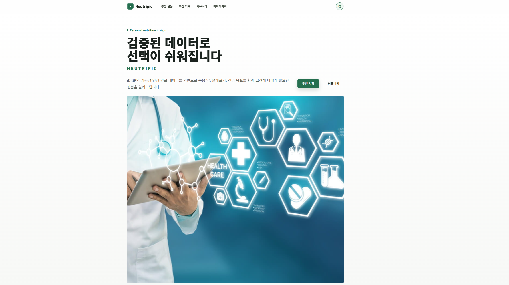

### 15.2 추천 설문

| 나이 입력 | 성별 선택 |
| --- | --- |
| 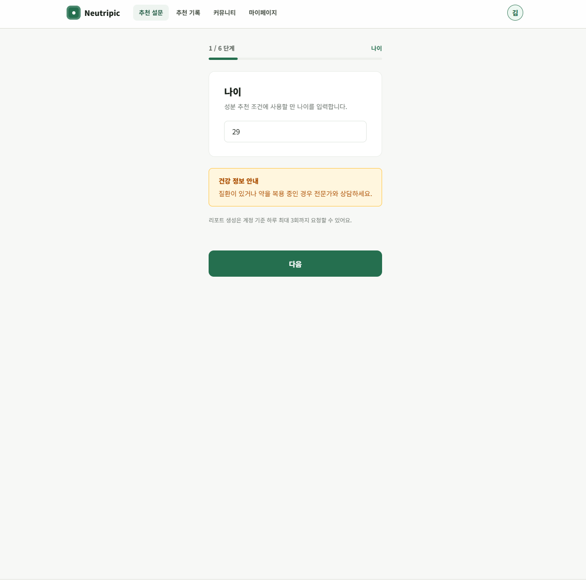 | 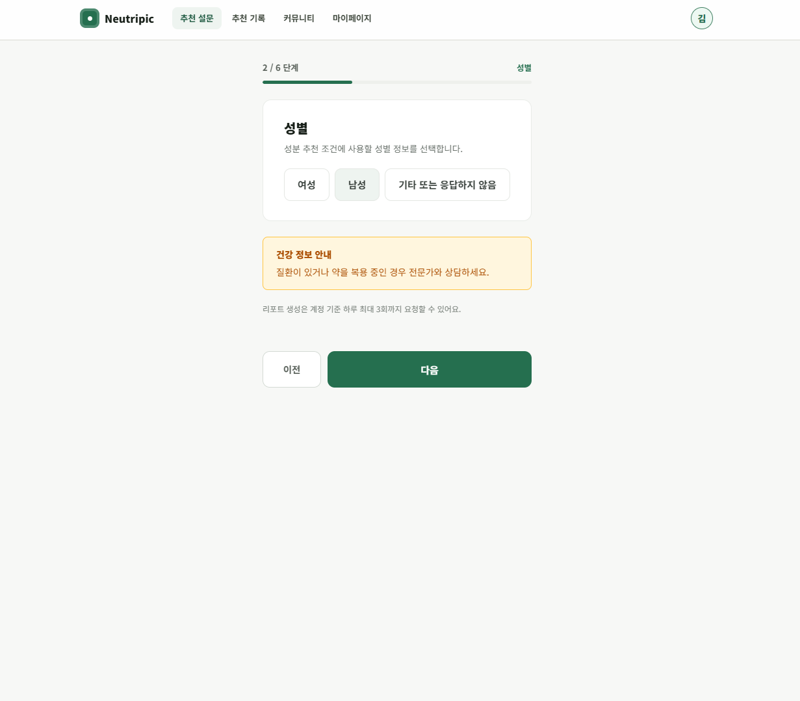 |

| 건강 목표 선택 | 복용 약 선택과 목표 우선순위 |
| --- | --- |
| 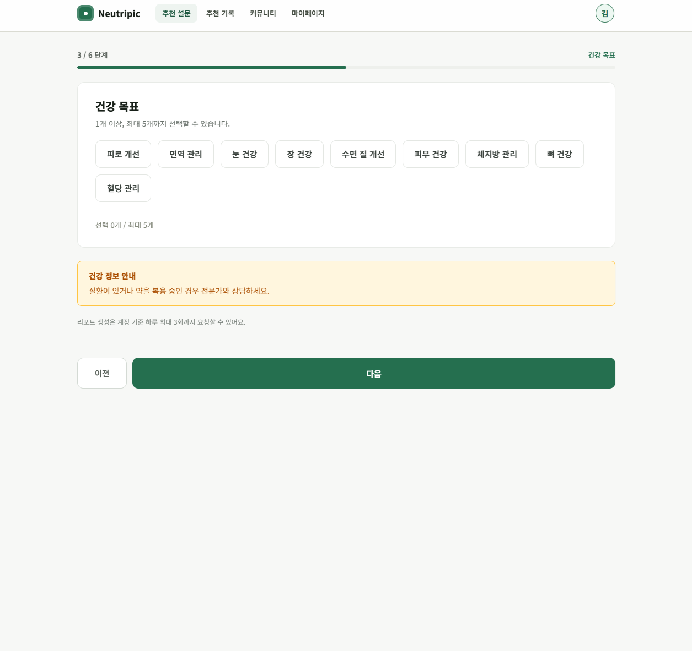 | 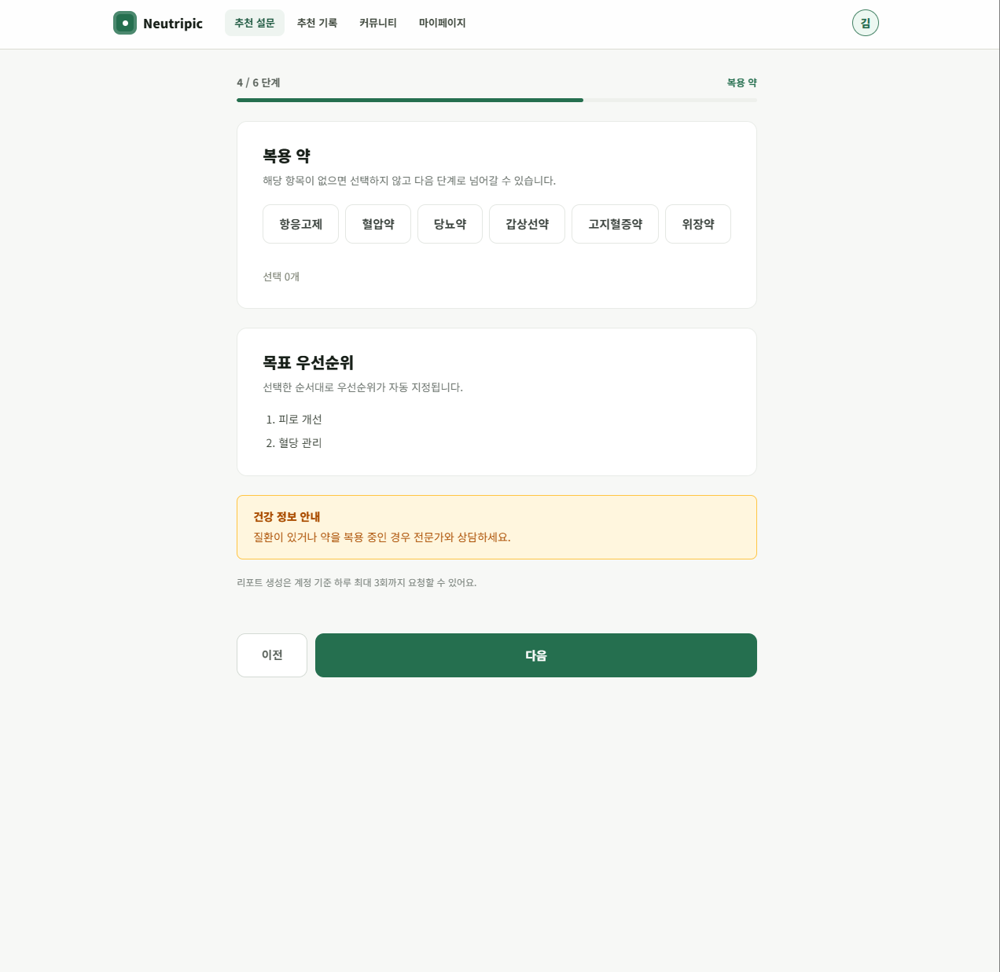 |

| 특이사항 선택 | 추가 정보 입력 |
| --- | --- |
| 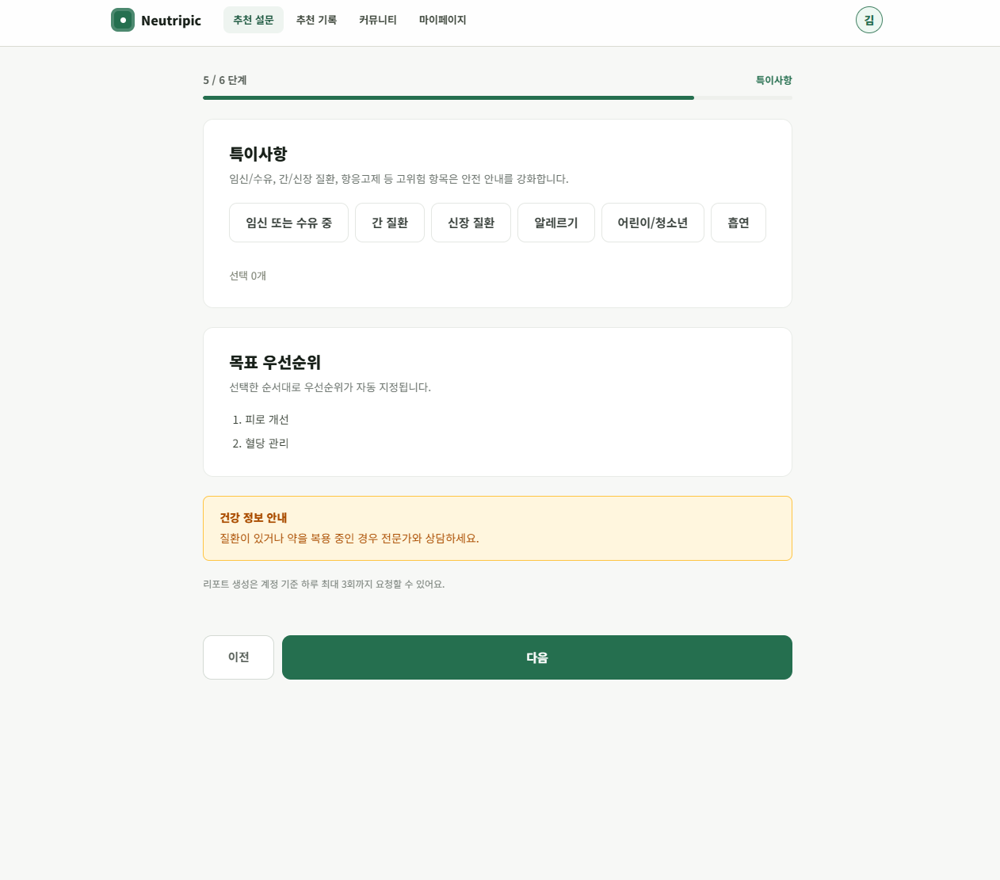 | 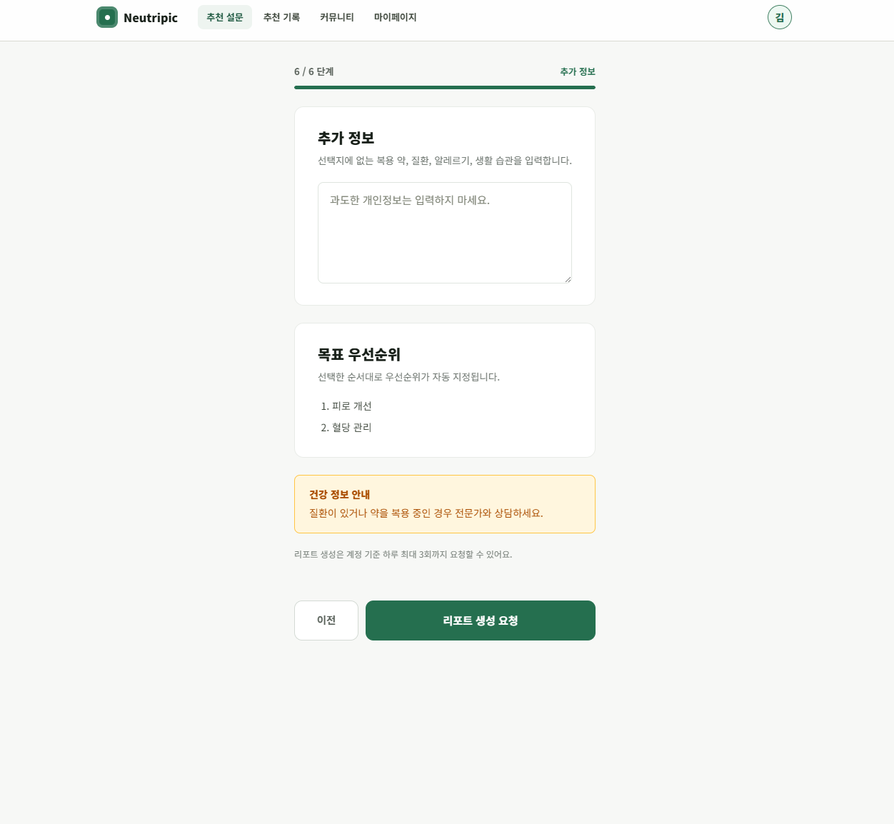 |

### 15.3 리포트와 채팅

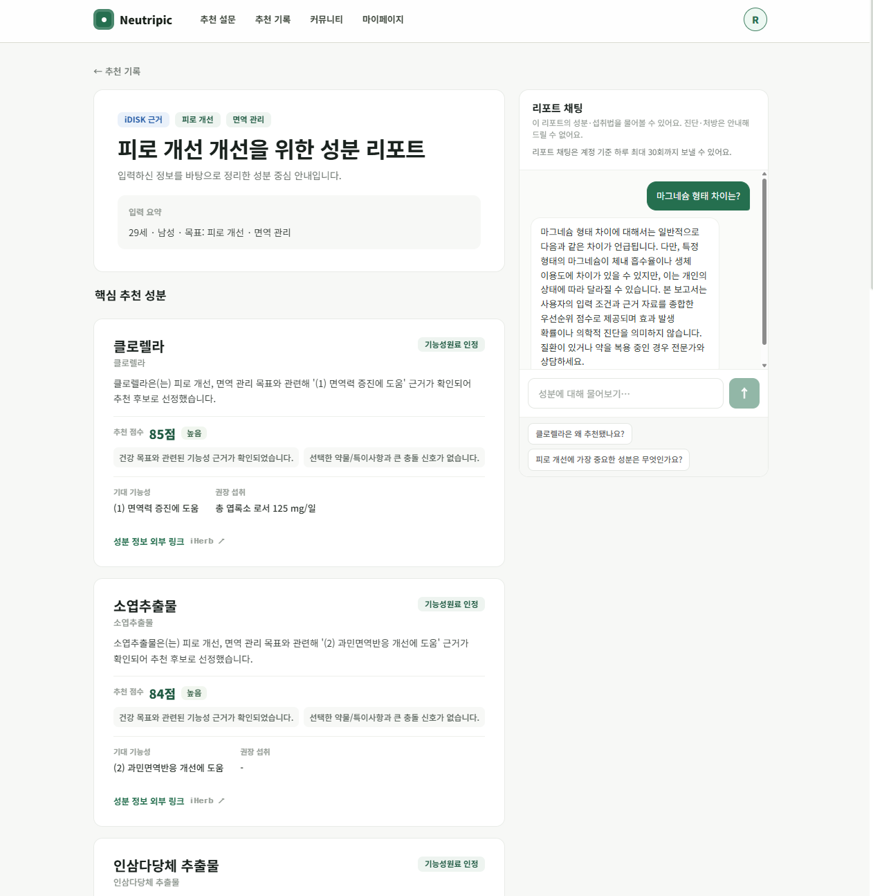

### 15.4 추천 기록

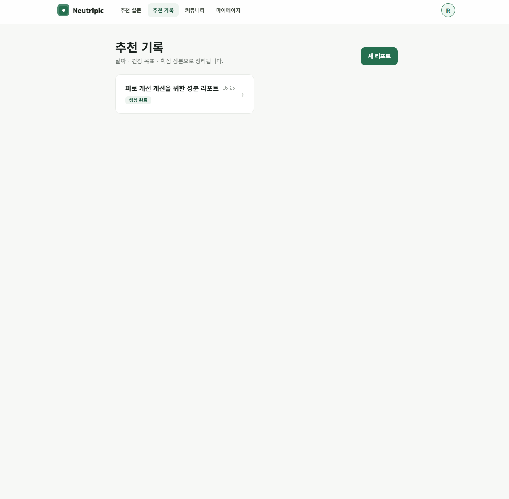

### 15.5 커뮤니티

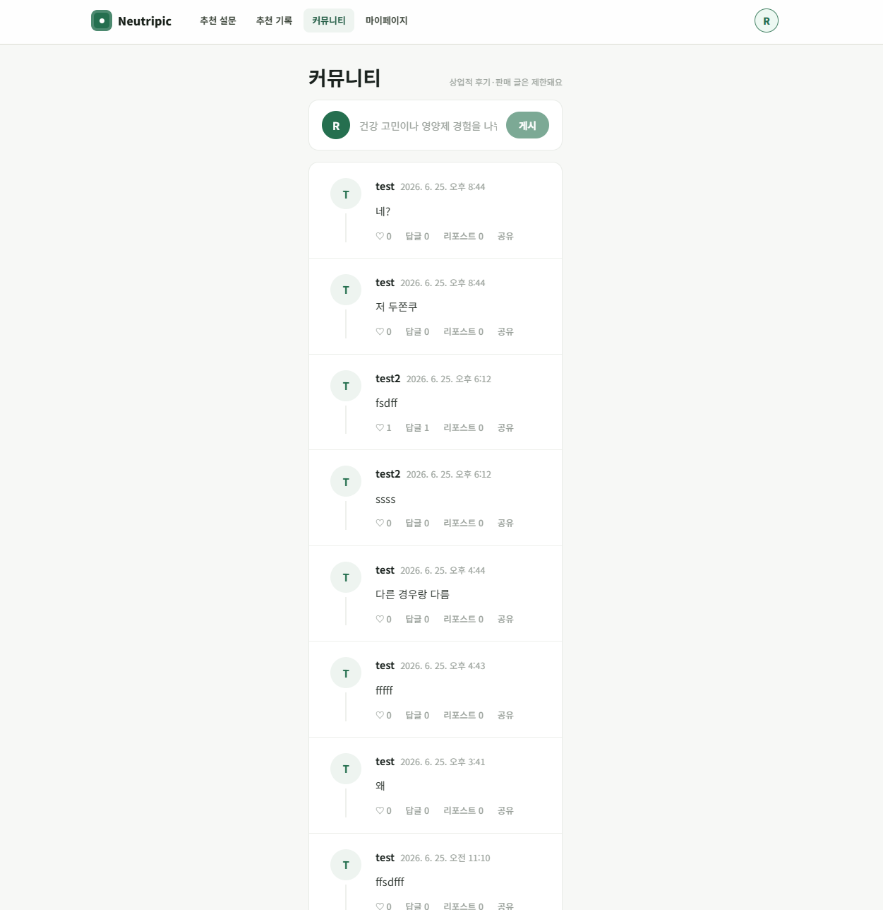

### 15.6 마이페이지

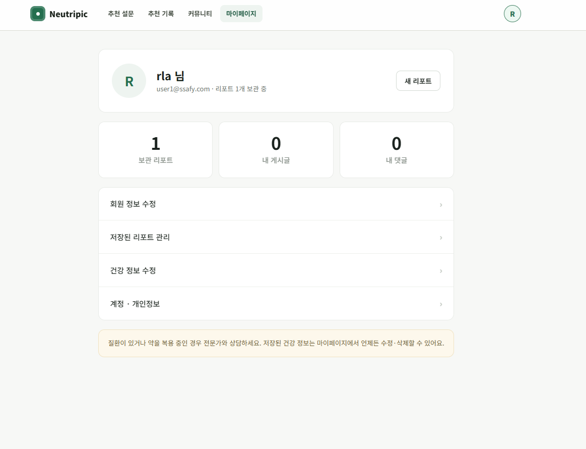

## 16. 프로젝트 산출물

- 소스코드: `frontend/`, `backend/`, `ai/`
- 데이터: `ai_data/`, `ai/app/data/`, `backend/reports/fixtures/`
- 기획 및 설계 문서: `docs/`
- 실행 화면 캡처: `docs/screenshots/`
- 제출 템플릿 원본: `(26_0622) 관통템플릿_Python_자율_15기_13회차.pdf`

## 17. 구현 정도와 남은 작업

### 구현된 주요 범위

- Vue SPA 라우팅과 인증 가드
- Django REST API 기본 구조
- JWT 인증과 사용자 API
- 추천 설문 metadata API
- 리포트 생성/조회/수정/삭제 API
- 리포트 메시지 API
- iHerb 성분 링크 매핑 import
- 커뮤니티 게시글/댓글/추천 API
- 관리자 회원/게시글/댓글 관리 API
- FastAPI AI 내부 API
- rule-based guardrail, normalize, RAG fallback, report/chat 응답 흐름

## 18. 배운 점과 느낀 점

### 김지윤 - Backend, AI, Data/Integration

백엔드와 AI/RAG 영역을 맡으면서 가장 크게 배운 것은 AI 기능도 결국 안정적인 서버 기능으로 제공되어야 한다는 점이다. 처음에는 “AI가 리포트를 잘 생성하는가”에 집중하기 쉬웠지만, 실제 서비스 흐름에서는 그 전에 인증, 사용자별 권한, 입력 검증, 사용량 제한, AI 서버 장애 처리, 결과 저장, 응답 schema 유지가 모두 필요했다.

Django 백엔드는 사용자 데이터와 서비스 정책의 중심으로 두고, FastAPI AI 서버는 정규화/RAG/생성 기능을 담당하도록 분리했다. 이 구조 덕분에 AI 서버 내부 로직을 바꾸더라도 프론트엔드는 Django API만 바라보면 되고, 사용자별 데이터 저장이나 권한 관리는 한 곳에서 통제할 수 있었다. 반대로 AI 서버 호출이 실패했을 때 백엔드가 `502`, `503` 형태로 표준화해 내려줘야 한다는 점도 직접 구현하며 배웠다.

가장 어려웠던 부분은 한국어 사용자 입력을 영어 기반 iDISK 데이터와 안정적으로 연결하는 과정이었다. 사용자는 “잠을 깊게 못 자요”, “피곤해요”처럼 자연어로 입력하지만, RAG 검색에서는 이를 내부 표준명과 영어 검색 질의로 변환해야 했다. 이 과정에서 정규화 사전, confidence, 검색 결과 score를 함께 고려해야 했고, 근거가 부족한 경우 무리하게 리포트를 생성하지 않는 흐름도 필요했다.

데이터 표준화도 쉽지 않았다. 기능성원료 데이터, iDISK 데이터, iHerb 링크 매핑 데이터가 각각 다른 기준과 필드명을 가지고 있어서, AI 서버와 백엔드가 공통으로 사용할 `normalized_name`, `source_type`, `document_id`, `metadata` 구조를 잡는 데 시간이 걸렸다. 특히 iHerb 링크는 사용자가 입력한 값을 URL로 바로 만들면 위험할 수 있어, 백엔드에서 허용 도메인과 매핑 테이블을 검증하는 방식으로 설계했다.

이번 프로젝트를 통해 AI 추천 기능은 모델 호출 하나로 완성되는 것이 아니라는 점을 체감했다. 사용자 입력 정규화, RAG 근거 검색, 검색 품질 판단, 추가 확인 질문, 출력 가드레일, 저장 안정성이 모두 맞물려야 서비스로 사용할 수 있는 추천 결과가 된다. 특히 건강 정보 서비스에서는 그럴듯한 답변보다 안전한 답변이 더 중요하다는 점을 배웠다.

### 정유진 - Frontend, AI, Data/Integration

프론트엔드와 AI/Data 연동 흐름을 맡으면서 가장 많이 배운 것은 사용자가 보는 화면은 단순히 데이터를 보여주는 곳이 아니라, 백엔드와 AI 서버의 복잡한 상태를 이해하기 쉽게 전달하는 역할을 한다는 점이다. 리포트 생성 기능은 성공만 있는 기능이 아니라 입력 검증 실패, 사용량 제한, 가드레일 차단, 추가 확인 질문, AI 서버 실패, RAG 검색 품질 부족 등 여러 상태를 가질 수 있었다. 이 상태들을 사용자가 혼란스럽지 않게 볼 수 있도록 화면 흐름과 안내 문구를 구성하는 것이 중요했다.

Vue SPA를 구현하면서 라우팅, 인증 가드, API 호출 상태 관리의 중요성을 느꼈다. 비회원이 접근 가능한 화면과 로그인 사용자가 접근해야 하는 화면, 관리자만 접근할 수 있는 화면을 구분해야 했고, 로그인 후 원래 가려던 페이지로 돌아가는 흐름도 필요했다. 이를 통해 프론트엔드에서도 단순 UI 구현뿐 아니라 서비스 권한 구조와 사용자 동선을 함께 이해해야 한다는 것을 배웠다.

AI 리포트 화면을 만들면서 데이터 구조를 화면에 맞게 해석하는 과정도 중요했다. 추천 성분에는 이름, 추천 이유, 기능성, 용량, 부작용, 주의사항, iHerb 링크, citations 등이 포함되는데, 이 정보를 한꺼번에 보여주면 사용자가 부담을 느낄 수 있다. 그래서 사용자 입력 요약, 핵심 추천 성분, 성분별 상세 정보, 의료 고지, 채팅 영역처럼 정보의 우선순위를 나누어 보여주는 것이 필요했다.

또한 백엔드와 AI 서버가 내려주는 응답 구조를 프론트엔드에서 안정적으로 사용하려면 API 계약이 명확해야 한다는 점을 느꼈다. 예를 들어 리포트 생성 결과가 `completed`인지 `needs_clarification`인지에 따라 화면 흐름이 달라지고, `questions`, `error_code`, `details` 같은 값이 있어야 사용자가 다음 행동을 알 수 있다. 이 경험을 통해 프론트엔드 개발자도 API 명세와 예외 케이스를 적극적으로 확인해야 한다는 것을 배웠다.

이번 프로젝트를 통해 AI 기능은 화면에 버튼 하나를 추가하는 수준이 아니라, 사용자 입력부터 결과 확인, 후속 채팅, 안전 안내까지 이어지는 전체 경험이라는 것을 느꼈다. 특히 건강 정보 서비스에서는 추천 결과를 화려하게 보여주는 것보다, 왜 추천되었는지와 어떤 상황에서 조심해야 하는지를 이해하기 쉽게 전달하는 것이 더 중요했다. 앞으로 비슷한 서비스를 만든다면 초기 단계부터 API 응답 상태, 로딩/실패 화면, 안전 문구, 데이터 표시 우선순위를 더 구체적으로 설계하고 시작하고 싶다.

### 협업하며 느낀 점

정유진이 프론트엔드를 맡아 화면과 사용자 흐름을 구현하고, 김지윤이 백엔드와 AI 서버 흐름을 맡으면서 “내 코드가 바로 다른 사람의 작업 기반이 된다”는 점을 많이 느꼈다. API 응답 하나가 애매하면 프론트엔드 구현도 흔들리고, 반대로 프론트엔드에서 필요한 상태를 이해하지 못하면 백엔드 응답도 사용하기 어려워진다. 그래서 기능 구현만큼이나 소통, 명세 정리, 예외 케이스 공유가 중요했다.

역할이 분리되어 있었기 때문에 각자 맡은 영역의 완성도뿐 아니라, 서로의 작업이 만나는 지점을 계속 확인해야 했다. 설문 payload, 리포트 응답 구조, 채팅 메시지 구조, 에러 응답 형식을 함께 맞추면서 API 명세가 협업의 언어라는 것을 크게 느꼈다. 앞으로는 정상 흐름뿐 아니라 실패 흐름과 예외 상태까지 초기에 함께 정의하면 더 안정적으로 협업할 수 있을 것 같다.
